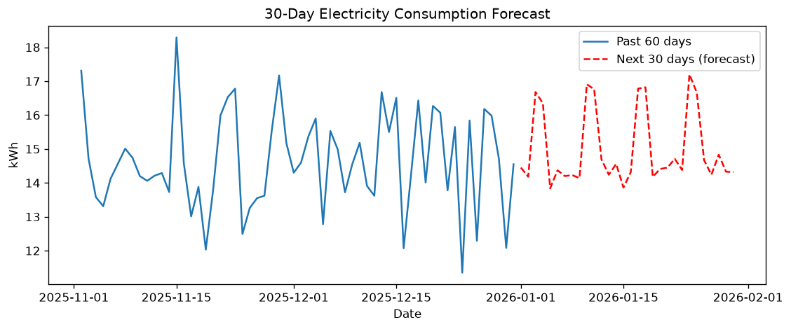

<div id="top"></div>
<p align="center">
  
  
  
  
  
</p>

---------------------------------------

<br/>
<div align="center">
  <a href="https://github.com/NotShadow1337/electricity-consumption-forecasting">
    
  </a>

  <h2 align="center">Electricity Consumption Analysis and Forecasting</h2>

</div>

---------------------------------------

# Features

- Creates a 3-year daily electricity dataset (2023-2025)
- Cleans missing values using interpolation
- Analysis of monthly, weekday and weekend usage
- Temperature vs consumption study
- Two machine learning models compared
- 30-day recursive forecast with estimated bill
- 5 graphs saved automatically

# Models Used

- Linear Regression
- Random Forest Regressor

# Results

| Model | MAE (kWh) | R2 |
|-------|-----------|-----|
| Linear Regression | 1.28 | 0.76 |
| Random Forest | **0.98** | **0.85** |

- Average usage: **16.47 kWh per day**
- Weekend usage (18.26 kWh) is higher than weekday usage (15.75 kWh)
- Temperature and usage correlation: **0.70**
- Forecast for next 30 days: **~449.8 kWh** (around Rs 3,148 at Rs 7 per unit)

# Installation

**1. Clone the repository**

```bash
git clone https://github.com/NotShadow1337/electricity-consumption-forecasting.git
cd electricity-consumption-forecasting
```

**2. Install requirements**

```bash
pip install -r requirements.txt
```

**3. Run**

```bash
python electricity_analysis.py
```

The graphs and the forecast file will be saved in the `output` folder.

# Configuration

You can change these things inside `electricity_analysis.py`:

- Date range of the dataset
- Base usage and AC usage values
- Train / test split ratio
- Number of forecast days
- Price per unit (default Rs 7)

To use your own data, make a CSV file with the columns `date`, `temperature`, `consumption`.

# Project Structure

```
electricity-consumption-forecasting/
├── README.md
├── electricity_analysis.py
├── requirements.txt
├── electricity_data.csv
└── output/
    ├── 1_daily_consumption.png
    ├── 2_monthly_average.png
    ├── 3_temperature_vs_consumption.png
    ├── 4_actual_vs_predicted.png
    ├── 5_forecast.png
    └── forecast_next_30_days.csv
```

# Disclaimer

- This project was made for educational purposes as a college Python mini project. The dataset is generated by the program, so the results show the concept and are not real meter readings.

- Forecasts are estimates and should not be used for real billing or energy planning decisions.

# Author

```py
author = {
    "name": "Shikhar Yadav",
    "roll_no": "25/SCA/BCOA/066",
    "github": "notshadow1337",
}
```
